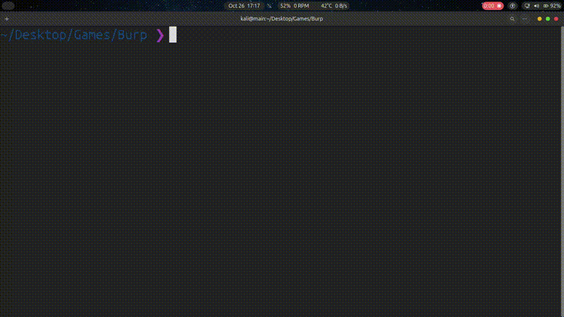

# burp2json

Convert Burp Suite project data into token-efficient JSON for LLMs.

`burp2json` is a Go command-line tool for turning a Burp Suite engagement into
something an LLM or a script can reason about: ordered headers, decoded bodies,
comments, highlights, timestamps, Site Map entries, Repeater tabs, and Collaborator
HTTP interactions. It is read-only and uses the Go standard library plus a small
Brotli decoder for `Content-Encoding: br`.

The output is `b2j/1`, a schema-once positional format designed for LLM context
windows. Header names and repeated values are interned, derivable fields are
removed, and large bodies/values are previewed with a recall sidecar so the full
data stays out of the main file.

> Only use this on targets you are authorised to test. The output can contain
> credentials, session tokens, personal data, and full response bodies. Review it
> before sharing, and prefer `--redact` when sending it to a third party.

## Demo




## Features

- Reads Burp project files (`.burp`) structurally, without requiring Burp itself.
- Also reads Burp "Save items" XML exports and HAR files.
- Preserves header order and duplicate headers as flat name/value index pairs.
- Decodes `gzip`, `deflate`, Brotli (`br`), and chunked bodies.
- Emits binary bodies as base64 instead of corrupting them, and moves base64
  bodies to the recall sidecar by default.
- Uses schema-once positional rows and a global string table to cut structural
  token overhead.
- Writes a `<output>.recall.json` sidecar for body/header previews so the main
  file stays small without losing the previewed values (subject to `--max-body`).
- Recovers Proxy history, Repeater tabs, Target Site Map entries, and Collaborator
  HTTP interactions where the project stores them.
- Supports comments, highlight colours, capture timestamps, and response titles
  where available.
- Deduplicates the same exchange across tools and records the other tools in each
  item's `also` list.
- Builds an application summary (hosts, endpoints, parameters, cookies, statuses,
  technologies, missing security headers, redirects, errors).
- Can split output into numbered parts for context-window limits.
- Shows a progress bar on stderr for large inputs on interactive terminals.
- Best-effort `--redact` mode for auth headers, cookies, JWTs, and secret-looking
  fields.

## Install

Requires Go 1.22 or newer.

```bash
go install github.com/cold-lapwing/burp2json@latest
```

The binary is installed into `$(go env GOPATH)/bin` (usually `~/go/bin`). Add that
directory to your `PATH` if it is not already there. You can also build from a clone:

```bash
git clone https://github.com/cold-lapwing/burp2json
cd burp2json
go build -o burp2json .
```

## Quick start

```bash
# Default: compact index + recall sidecar
burp2json engagement.burp -o engagement.json

# Disable preview caps and inline base64 bodies (still subject to --max-body)
burp2json engagement.burp -o engagement.full.json --full

# Redact common secrets before sharing
burp2json engagement.burp -o engagement.redacted.json --redact

# Keep one host only
burp2json engagement.burp -o api.json --host api.example.com

# Split a large export into 200-item parts (each part gets its own recall sidecar)
burp2json engagement.burp -o engagement.json --chunk-items 200

# XML or HAR exports
burp2json saved-items.xml -o saved.json
burp2json capture.har -o capture.json
```

The input file is opened read-only and is never modified. If `-o` is omitted the
output is written next to the input as `<input>.json`. When compact mode elides a
value, the full values are written to `<output>.recall.json` in the same
directory.

For inputs of 1 MiB or more, an interactive terminal also shows a progress bar on
stderr while the file is read, parsed, and written. Progress is disabled
automatically when stderr is redirected, and can be forced off with
`--no-progress`.

## CLI options

| Option | Meaning |
| --- | --- |
| `-o, --output PATH` | Output JSON path. Default: `<input>.json`. |
| `--format {burp,xml,har}` | Force the input format instead of auto-detecting. |
| `--max-body BYTES` | Maximum body bytes kept per message. Default: `200000`. |
| `--body-preview BYTES` | Bytes of each body kept inline in the compact file. Default: `1024`; `0` keeps full text bodies (base64 still needs `--full`). |
| `--header-max BYTES` | Maximum bytes per interned header value/comment/title. Default: `512`; `0` keeps full values. |
| `--full` | Disable compact preview caps and inline base64 bodies (still subject to `--max-body`). |
| `--host TEXT` | Keep only items whose host contains `TEXT`. Repeatable. |
| `--redact` | Redact sensitive headers, cookies, JWTs, and secret-looking fields. |
| `--chunk-items N` | Write `*_part001.json`, `*_part002.json`, ... with `N` items each. |
| `--no-summary` | Omit the top-level `summary` object. |
| `--no-progress` | Disable the progress bar even on an interactive terminal. |

## Output shape

The output file is `b2j/1`: JSON with a schema, a global string table, and
positional rows. It is intentionally optimized for an LLM reader, not for human
diffing.

```jsonc
{
  "format": "b2j/1",
  "read": "b2j/1: schema-once JSON for LLMs. ...",
  "recall": "engagement.recall.json",
  "meta": {
    "tool": "burp2json",
    "version": "2.2.0",
    "source": "engagement.burp",
    "sha256": "...",
    "bytes": 16777216,
    "input": "burp",
    "method": "burp-heap",
    "at": "2026-10-22T09:47:40.000000+00:00",
    "read_only": true,
    "items": 95,
    "tools": {"proxy": 11, "site-map": 84},
    "burp": {
      "magic": "0x66858280",
      "outer_version": 1,
      "compat": "0x80527974",
      "schema": 217,
      "project": "engagement"
    },
    "warnings": ["242 framed HTTP record(s) were not linked ..."]
  },
  "schema": {
    "item": ["id", "tool", "also", "time", "url", "status", "title",
             "comment", "highlight", "request", "response", "warnings"],
    "request": ["method", "target", "http_version", "headers",
                "body", "body_encoding", "orig_bytes", "ref"],
    "response": ["reason", "http_version", "headers",
                 "body", "body_encoding", "orig_bytes", "ref"],
    "interaction": ["type", "host", "method", "path", "response_status",
                    "response_server", "request", "response"],
    "host": ["host", "count", "ports", "protocols"],
    "endpoint": ["host", "method", "path", "count", "statuses", "params"]
  },
  "strings": ["site-map", "proxy", "Host", "chatgpt.com", "Cookie", "sid=...",
              "Content-Type", "text/html"],
  "items": [
    [1, 1, [0], 1792661035929, "https://chatgpt.com/", 200, null, null, "none",
     ["GET", "/", "HTTP/2", [2, 3, 4, 5], "", null, null, null],
     ["OK", "2", [6, 7], "<!DOCTYPE html>...", null, 651480, "1p"],
     null]
  ],
  "summary": {
    "total": 95,
    "hosts": [["chatgpt.com", 95, [443], ["https"]]],
    "endpoints": [["chatgpt.com", "GET", "/", 1, [[200, 1]], []]],
    "methods": {"GET": 66, "POST": 29},
    "status": {"200": 81, "202": 9, "302": 3, "403": 2},
    "content_types": {"application/json": 59},
    "params": ["..."],
    "cookies": ["..."],
    "auth": ["Authorization"],
    "redirects": [[17, 302, "/home"]],
    "highlights": {"none": 11}
  },
  "collaborator": {
    "domains": ["...oastify.com"],
    "types": ["HTTP"],
    "interactions": [
      ["HTTP", "...oastify.com", "GET", "/.git/HEAD", 200,
       "Burp Collaborator https://burpcollaborator.net/",
       ["GET", "/.git/HEAD", "HTTP/1.1", [2, 3], "", null, null, null],
       ["OK", "1.1", [4, 5], "<html>...</html>", null, null, null]]
    ]
  },
  "repeater": {"tabs": [], "groups": []},
  "coverage": {"proxy_items": 11, "site_map_messages": 95}
}
```

Reading rules:

- `schema` names every positional field. Read it once, then read rows as tuples.
- `strings` is a global table. `item.tool`, `item.also[]`, `item.title`,
  `item.comment`, and both halves of every header pair are indexes into it.
  Other strings (URL, target, header values in the sidecar, summary strings) are
  direct values.
- Headers are flat `[nameIndex, valueIndex, ...]` pairs in wire order, so
  duplicate and ordered headers survive.
- Request rows are `[method, target, http_version, headers, body,
  body_encoding, orig_bytes, ref]`.
- Response rows are `[reason, http_version, headers, body, body_encoding,
  orig_bytes, ref]`.
- `body_encoding` is `null` for UTF-8, or `base64` / `latin-1` when needed.
  `orig_bytes` is non-null when the body was truncated or moved to recall
  (base64). `ref` names a body in the recall sidecar.
- `time` is Unix milliseconds. `status` is the response status code. The URL
  carries scheme, host, port, path, and query. Path, query parameters, cookies,
  and body parameters are derivable from the target/headers/body, so they are not
  repeated.
- `also` lists other Burp tools that stored the same exchange.
- Base64 bodies are not inlined by default because base64 prefixes tokenize
  badly; they are available in the recall sidecar. `--full` inlines them.

### Recall sidecar

When compact output elides data (a body/header preview, a capped string, or a
base64 body), the main file's `recall` field points at `<output>.recall.json`:

```jsonc
{
  "format": "b2j-recall/1",
  "read": "b2j-recall/1: full values omitted from the b2j/1 file. ...",
  "strings": {"s42": "full untruncated value"},
  "bodies": {"1p": "full response body available to the converter"}
}
```

- `strings` keys are `s<index>` for the matching `strings[]` entry.
- `bodies` keys are `<itemId>r` / `<itemId>p` for requests/responses, and
  `c<n>r` / `c<n>p` for Collaborator interaction `n`.
- A recall body may already be shorter than `orig_bytes` if `--max-body` capped
  it before compaction.
- `--full` disables all compact preview caps and base64 elision, so no recall
  sidecar is written. Body data already dropped by `--max-body` is not
  recoverable.

For chunked output, each `*_partNNN.json` gets its own
`*_partNNN.recall.json` sidecar. The sidecar contains the same redactions as the
main file; protect both. `summary.total` covers the full result set while
`meta.items` is the number of rows in that part.

## Token efficiency

The development sample was a 16 MiB schema-217 project with 95 HTTP items. Counts
below use `tiktoken` with `o200k_base` (`scripts/token_count.py`; install it with
`python3 -m pip install tiktoken`):

| Output | Tokens | Bytes |
| --- | ---: | ---: |
| `b2j/1` with `--full` | 1,337,419 | 2,958,197 |
| `b2j/1` default | 96,130 | 210,799 |

The default keeps the main file to about 96k tokens while retaining every item,
header name, endpoint, and a 1 KiB body prefix. For comparison, the removed
verbose format produced 2,485,776 tokens for this sample, so the default is about
25.9x smaller. The recall sidecar is about 2.7 MiB on this sample, but an LLM only
reads it if it needs a specific full body or header value.

The format borrows the useful parts of RTK's TOON/minify-json/dedup/cap+recall
ideas: schema once, deduplicate repeated structure, and make lossy previews
retrievable instead of unreadable.

## How extraction works

### 1. Burp project heap (`.burp`)

Current Burp projects are not a container of standalone HTTP messages. They are an
append-only object heap:

- a 72-byte big-endian header with magic `0x66858280`, compatibility value
  `0x80527974`, schema numbers, allocation cursor, and project root address;
- compact self-describing objects with a flags byte, type/subtype, a field table, and
  field values at relative offsets;
- length-framed byte records (`total`, `logical`, payload) for raw HTTP messages,
  strings, and arrays;
- chunked collections used for history rows and identity indexes.

`burp2json` walks the object graph from the header's project root. It does not scan
for strings and guess. For a schema-217 project it reads:

- **Proxy history** rows: method, service (host/port/TLS), comment, highlight,
  listener port, status, Burp MIME code, response length, title, cookie header,
  timestamp, client IP, and request/response frame addresses.
- **Repeater** tabs and pairs: caption, UUID, group, and each request/response pair.
- **Target Site Map** identity index: buckets of 24-byte `(hash, node, value)` tuples;
  each node points at an HTTP message object with request, response, and timestamp.
- **Collaborator** HTTP interactions: framed requests containing a Collaborator
  payload domain, paired with the nearest Collaborator response frame.

Exchanges are deduplicated by SHA-256 of the exact request and response bytes. When
the same exchange exists in several tools, the item keeps the higher-priority source
(`proxy` > `repeater` > `site-map` > `unknown`) and lists the others in `also`.

If the header or schema is not recognised, the structural parser is skipped and a
byte-level HTTP carver is used. The carver also inspects zlib/gzip blobs, but it
cannot recover tool names, comments, highlights, Repeater metadata, or Collaborator
pairing.

### 2. Burp XML export

Proxy / Repeater / Logger / Site Map items exported with Burp's "Save items" are
parsed from `<items><item>...` elements, including base64-encoded request and
response elements. The item `type` is normalised to `proxy`, `repeater`, `site-map`,
`logger`, and so on.

### 3. HAR

HAR entries are mapped directly. Request URLs supply host, port, and scheme, and
HAR `postData` / `content` bodies are decoded. HAR files do not contain Collaborator
metadata.

## What is recovered, and what is not

| Area | Status |
| --- | --- |
| Proxy HTTP history | Recovered structurally (schema-217). |
| Repeater tabs and pairs | Recovered structurally. |
| Target Site Map HTTP messages | Recovered structurally. |
| Collaborator HTTP interactions | Recovered from framed request/response records. |
| Comments, highlights, timestamps | Recovered where the heap stores them. |
| Duplicate/ordered headers | Preserved. |
| Compressed and chunked bodies | Decoded. |
| Binary bodies | Base64. |
| Intruder configuration/results | Not recovered. |
| Scanner issue/task ownership | Not mapped. |
| Collaborator DNS/SMTP interactions | Not recovered (only HTTP frames are present). |
| Exact Burp release | Not stored in the project format; only the schema is reported. |

The heap is append-only, so deleted or superseded objects and old HTTP frames remain
in the file. The parser only promotes frames that are referenced by Proxy, Repeater,
Site Map, or Collaborator metadata. Other reachable frames (for example WebSocket
handshake requests and old history entries) are counted in
`coverage.unattributed_frames` and reported in `meta.warnings` instead of being
silently presented as Proxy traffic.

## Real sample results

The development sample was a 16 MiB schema-217 project captured against
`chatgpt.com`. The structural parser produced:

| Metric | Value |
| --- | --- |
| Unique HTTP items | 95 |
| Proxy items | 11 |
| Site Map messages | 95 (84 not already in Proxy) |
| Repeater pairs | 0 (one empty tab) |
| Collaborator HTTP interactions | 5 |
| Unique Collaborator payload domains | 2 |
| Comments | 4 (`"js"`) |
| Framed HTTP records found | 442 |
| Unattributed records | 242 (other heap branches / WebSocket handshakes) |
| Protocols / ports | all `https`, port `443` |
| Statuses | 200: 81, 202: 9, 302: 3, 403: 2 |

The sample itself is intentionally not committed because it contains live session
material.

## Redaction

`--redact` is a safety aid, not a guarantee. It currently:

- replaces values of `Authorization`, `Proxy-Authorization`, `Cookie`, `Set-Cookie`,
  `X-Api-Key`, CSRF/auth token headers, and similar headers;
- replaces cookie values in the request's parsed `cookies` object and Burp's stored
  history cookie column;
- replaces JWT-shaped strings;
- redacts body/query/form keys whose names look like passwords, secrets, tokens,
  keys, auth, or sessions;
- redacts Collaborator request/response messages too.

It does **not** reliably redact secrets embedded in free-form response bodies, HTML,
JavaScript, or unusual header names. Always review the output and any
`.recall.json` sidecar before sharing them.

## Reverse-engineering notes

The `.burp` layout was derived by inspecting the shipped artifact rather than by
relying on Burp's UI: header fields, object descriptors, field widths, framed
records, chunked-collection layout, and the schema-217 field meanings were verified
against the sample. The REA methodology and CLI were used for artifact triage; the
generic `rea inspect-artifact` command does not recognise `.burp` as a supported
binary container, so the heap parser is purpose-built. RTK was used to keep probe
and test output compact during development.

Key format facts worth preserving:

- header: 72 bytes, big-endian; magic `0x66858280`, outer version `1`,
  compatibility `0x80527974`;
- object: `flags` (1), `type` (1), `subtype` (1), `count` (1), then `count`
  three-byte `(field_id, relative_offset)` entries;
- framed record: `total` and `logical` int32 values followed by `logical` bytes;
- address arrays use 8-byte addresses; Site Map tuples use 24 bytes;
- schema 217 Proxy row field 3 is the comment; newer schemas may use field 27;
- service host is an immutable string wrapper; port is an int32 and TLS is the
  following byte (do not read port and TLS as one int64).

## Repository layout

```text
main.go                         thin entrypoint; keeps `go install ...@latest` working
internal/burp2json/
  doc.go                        package documentation
  app.go                        CLI flags, orchestration, output and chunk writing
  compact.go                    b2j/1 output, interning, recall sidecar
  progress.go                   terminal progress bar
  model.go                      shared parser and output data types
  httpmsg.go                    HTTP parsing, body decoding, URL inference
  burp.go                       structural schema-217 heap parser
  carver.go                     fallback byte-level HTTP carver
  xmlhar.go                     Burp XML and HAR readers
  transform.go                  deduplication, finalisation, redaction, summary
  *_test.go                     package tests and synthetic heap fixture
testdata/                       local-only fixtures (ignored by Git)
scripts/token_count.py          tiktoken benchmark helper
go.mod / go.sum                 module and Brotli dependency
README.md                       this document
.gitignore                      ignores engagement data, generated JSON, build artifacts
```

## License

Add the license your engagement or organisation requires. No license is implied by
this repository.
